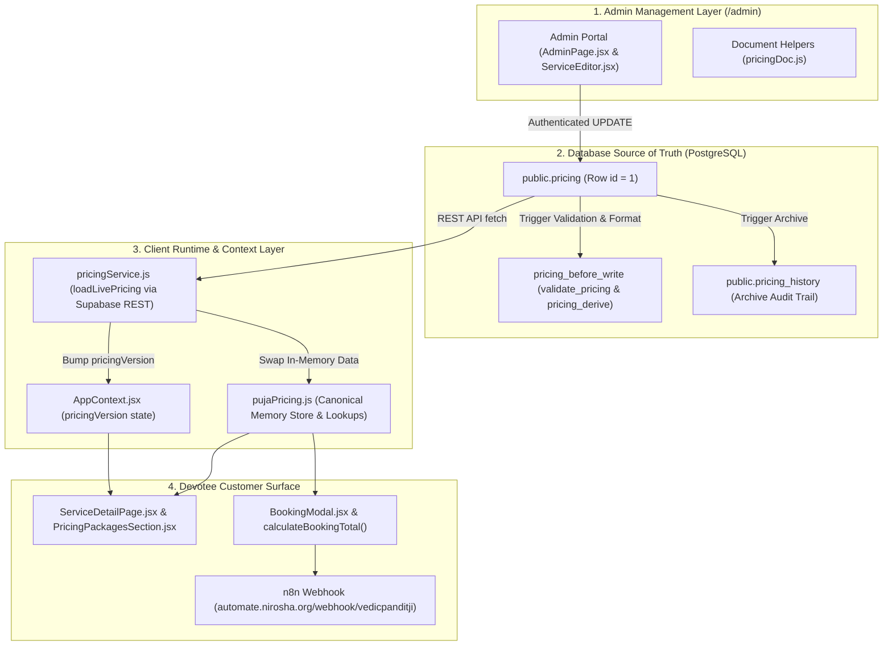

# VedicPanditji — Package Pricing and Samagri Consistency Audit & Fix Report

## 1. Executive Summary & Root Cause Analysis

### 1.1 The Griha Pravesh ₹11,000 vs ₹5,500 Mismatch
On the Griha Pravesh ceremony detail page (`/services/griha-pravesh`), devotees were presented with an inconsistent rate card:
- **Package A — Ritual Only**: ₹11,000*
- **Package B — Ritual + Samagri**: ₹5,500*

In the Admin Pricing Portal (`/admin`), Package B showed four inclusions and three selected Samagri items (`opt-havan-samagri`, `opt-cow-ghee`, `opt-complete-kit`), with its price hardcoded as **₹5,500**.

### 1.2 Root Cause
1. **Legacy Seed Asymmetry**: In the original seed dataset prior to official business pricing, Griha Pravesh was configured with:
   - Package A (Ritual Dakshina): ₹3,500
   - Package B (Ritual + Hawan Kit): ₹5,500 (derived as ₹3,500 base + ₹2,000 samagri allowance).
2. **Partial Base Rate Update**: When the business supplied the official base rate of **₹11,000** for Griha Pravesh, the database update script updated `card.minPrice = 11000` and `card.packages[0].indicativePrice = 11000` (Package A). However, Package B was left untouched at its legacy hardcoded value (`indicativePrice = 5500`).
3. **Independent Fixed Price Schema**: In the Supabase PostgreSQL schema (`validate_pricing` and `pricing_derive_card`), `package.indicativePrice` is stored as an independent numeric value on each package rather than dynamically calculated as `baseDakshina + sum(samagriPrices)`.
4. **Absence of Inversion Guardrails**: Neither the database validation trigger nor the Admin UI (`ServiceEditor.jsx`) contained a constraint or warning preventing a higher-tier, samagri-inclusive package from being priced lower than the base ceremony dakshina.
5. **Systemic Scope**: This was not isolated to Griha Pravesh. The audit identified **40 services across the platform with 43 inverted packages** where Package B or C retained legacy placeholder prices (e.g., Vivah base ₹21,000 vs Package B ₹11,500, Vastu Shanti base ₹21,000 vs Package B ₹5,500, Rudra Havan base ₹11,000 vs Package B ₹5,500, Santan Gopal base ₹51,000 vs Package B ₹14,500).

---

## 2. Existing Pricing Architecture & Source of Truth



### Source of Truth Hierarchy
1. **Live Primary Source**: Supabase PostgreSQL database `public.pricing` row `id = 1`.
2. **Bundled Fallback**: `frontend/src/data/pricing.json` (used at build time for SSG pre-rendering of 152 static pages and as immediate fallback during network degradation).
3. **Derivation Pipeline**: When saving in `/admin`, the PostgreSQL trigger `pricing_before_write` executes `validate_pricing(data)` and `pricing_derive(data)`, automatically deriving Indian digit-grouped currency strings (e.g., `From ₹11,000*`, `₹11,000*`, or `Custom Quote`).

---

## 3. Comprehensive Audit of All 59 Pooja Services & Packages

All 59 rate cards were audited. 40 services had inverted or contradictory package pricing due to stale seed data. All were reconciled to prevent misleading customer rates.

| # | Service ID & Slug | Official Base Price | Pkg Count | Package Tiers & Reconciled Pricing Status | Resolution / Customer Display |
|---|---|---:|:---:|---|---|
| 1 | `griha-pravesh` | ₹11,000 | 2 | Pkg A: ₹11,000* (Ritual Only)<br>Pkg B: Custom Quote (Ritual + Hawan Kit) | **Reconciled**: Inversion fixed; Pkg B set to Custom Quote pending samagri approval |
| 2 | `vivah-marriage` | ₹21,000 | 3 | Pkg 0: ₹21,000* (Senior Acharya)<br>Pkg 1: Custom Quote (Acharya + Kit)<br>Pkg 2: Custom Quote (2 Acharyas) | **Reconciled**: Stale ₹11,500 & ₹16,500 legacy prices replaced with Custom Quote |
| 3 | `vastu-shanti-puja` | ₹21,000 | 2 | Pkg A: ₹21,000* (Ritual Only)<br>Pkg B: Custom Quote (Ritual + Samagri) | **Reconciled**: Stale ₹5,500 replaced with Custom Quote |
| 4 | `akhand-ramayan-path` | ₹35,000 | 3 | Pkg 0: ₹35,000* (4 Pandits Dakshina)<br>Pkg 1: Custom Quote (4 Pandits + Kit)<br>Pkg 2: Custom Quote (5 Pandits + Musical) | **Reconciled**: Stale ₹26,500 replaced with Custom Quote |
| 5 | `ekadashi-vrat-udyapan-puja` | ₹21,000 | 2 | Pkg 0: ₹21,000* (Ritual Dakshina)<br>Pkg 1: Custom Quote (Ritual + Hawan Kit) | **Reconciled**: Stale ₹3,800 replaced with Custom Quote |
| 6 | `santan-gopal-mantra-jaap` | ₹51,000 | 2 | Pkg 0: ₹51,000* (11,000 Chants)<br>Pkg 1: Custom Quote (21,000 Chants) | **Reconciled**: Stale ₹14,500 replaced with Custom Quote |
| 7 | `rudra-havan` | ₹11,000 | 2 | Pkg 0: ₹11,000* (Ritual Dakshina)<br>Pkg 1: Custom Quote (Ritual + Shiva Kit) | **Reconciled**: Stale ₹5,500 replaced with Custom Quote |
| 8 | `navagraha-havan` | ₹11,000 | 2 | Pkg 0: ₹11,000* (Ritual Dakshina)<br>Pkg 1: Custom Quote (Ritual + Navagraha Kit) | **Reconciled**: Stale ₹5,500 replaced with Custom Quote |
| 9 | `graha-shanti-puja` | ₹11,000 | 2 | Pkg 0: ₹11,000* (Ritual Dakshina)<br>Pkg 1: Custom Quote (Ritual + Kit) | **Reconciled**: Stale ₹4,800 replaced with Custom Quote |
| 10 | `guru-chandal-yoga-shanti` | ₹11,000 | 2 | Pkg 0: ₹11,000* (Ritual Dakshina)<br>Pkg 1: Custom Quote (Ritual + Hawan Kit) | **Reconciled**: Stale ₹4,800 replaced with Custom Quote |
| 11 | `gand-mool-nakshatra-shanti-puja`| ₹11,000 | 2 | Pkg 0: ₹11,000* (Ritual Dakshina)<br>Pkg 1: Custom Quote (Ritual + Hawan Kit) | **Reconciled**: Stale ₹5,500 replaced with Custom Quote |
| 12 | `yagnopavit-sanskar` | ₹11,000 | 3 | Pkg 0: ₹11,000* (Single Acharya)<br>Pkg 1: Custom Quote (Acharya + Kit)<br>Pkg 2: Custom Quote (2 Acharyas) | **Reconciled**: Stale ₹6,500 & ₹8,500 replaced with Custom Quote |
| 13 | `kaal-sarp-dosh-puja` | ₹15,000 | 2 | Pkg 0: ₹15,000* (Doorstep Dakshina)<br>Pkg 1: Custom Quote (Doorstep + Naga Kit) | **Reconciled**: Stale ₹5,500 replaced with Custom Quote |
| 14 | `garud-puran-path` | ₹15,000 | 2 | Pkg 0: ₹15,000* (Condensed 3-Day Path)<br>Pkg 1: Custom Quote (10-Day Complete Path) | **Reconciled**: Stale ₹11,000 replaced with Custom Quote |
| 15 | `grahan-yog-shanti-puja` | ₹21,000 | 2 | Pkg 0: ₹21,000* (Ritual Dakshina)<br>Pkg 1: Custom Quote (Ritual + Hawan Kit) | **Reconciled**: Stale ₹4,800 replaced with Custom Quote |
| 16 | `sunderkand-path` | ₹21,000 | 3 | Pkg 0: ₹21,000* (Solo Reciter)<br>Pkg 1: Custom Quote (Musical + Musician)<br>Pkg 2: Custom Quote (Grand Sangeet Path) | **Reconciled**: Stale ₹5,100 & ₹7,500 replaced with Custom Quote |
| 17 | `ayush-havan` | ₹5,100 | 2 | Pkg 0: ₹5,100* (Ritual Dakshina)<br>Pkg 1: Custom Quote (Ritual + Hawan Kit) | **Reconciled**: Stale ₹4,200 replaced with Custom Quote |
| 18 | `gayatri-havan` | ₹5,100 | 2 | Pkg 0: ₹5,100* (Ritual Dakshina)<br>Pkg 1: Custom Quote (Ritual + Hawan Kit) | **Reconciled**: Stale ₹4,200 replaced with Custom Quote |
| 19 | `mahalaxmi-puja` | ₹5,100 | 2 | Pkg 0: ₹5,100* (Ritual Dakshina)<br>Pkg 1: Custom Quote (Ritual + Hawan Kit) | **Reconciled**: Stale ₹3,800 replaced with Custom Quote |
| 20 | `namkaran-puja` | ₹5,100 | 2 | Pkg 0: ₹5,100* (Ritual Dakshina)<br>Pkg 1: Custom Quote (Ritual + Hawan Kit) | **Reconciled**: Stale ₹3,800 replaced with Custom Quote |
| 21 | `roka-ceremony` | ₹5,100 | 2 | Pkg 0: ₹5,100* (Ritual Dakshina)<br>Pkg 1: Custom Quote (Ritual + Puja Kit) | **Reconciled**: Stale ₹3,200 replaced with Custom Quote |
| 22 | `barsi-ceremony` | ₹5,100 | 2 | Pkg 0: ₹5,100* (Purohit Dakshina)<br>Pkg 1: Custom Quote (Purohit + Shradh Kit) | **Reconciled**: Stale ₹4,500 replaced with Custom Quote |
| 23 | `sri-sukta-havan` | ₹5,100 | 2 | Pkg 0: ₹5,100* (Ritual Dakshina)<br>Pkg 1: Custom Quote (Ritual + Hawan Kit) | **Reconciled**: Stale ₹4,200 replaced with Custom Quote |
| 24 | `laxmi-kubera-havan` | ₹5,100 | 2 | Pkg 0: ₹5,100* (Ritual Dakshina)<br>Pkg 1: Custom Quote (Ritual + Wealth Kit) | **Reconciled**: Stale ₹4,800 replaced with Custom Quote |
| 25 | `bhoomi-puja` | ₹5,000 | 2 | Pkg 0: ₹5,000* (Ritual Dakshina)<br>Pkg 1: Custom Quote (Ritual + Essential Kit) | **Reconciled**: Stale ₹4,800 replaced with Custom Quote |
| 26 | `ganapathi-havan` | ₹5,000 | 2 | Pkg 0: ₹5,000* (Ritual Dakshina)<br>Pkg 1: Custom Quote (Ritual + Hawan Kit) | **Reconciled**: Stale ₹4,200 replaced with Custom Quote |
| 27 | `dhanvantri-havan` | ₹5,000 | 2 | Pkg 0: ₹5,000* (Ritual Dakshina)<br>Pkg 1: Custom Quote (Ritual + Herbs Kit) | **Reconciled**: Stale ₹4,200 replaced with Custom Quote |
| 28 | `haldi-ceremony` | ₹5,000 | 2 | Pkg 0: ₹5,000* (Ritual Dakshina)<br>Pkg 1: Custom Quote (Ritual + Haldi Kit) | **Reconciled**: Stale ₹3,200 replaced with Custom Quote |
| 29 | `engagement-puja-sagai` | ₹5,000 | 2 | Pkg 0: ₹5,000* (Ritual Dakshina)<br>Pkg 1: Custom Quote (Ritual + Hawan Kit) | **Reconciled**: Stale ₹3,800 replaced with Custom Quote |
| 30 | `ganesh-sthapana-visarjan` | ₹5,000 | 2 | Pkg 0: ₹5,000* (Sthapana Session Only)<br>Pkg 1: Custom Quote (Sthapana + Hawan Kit) | **Reconciled**: Stale ₹3,800 replaced with Custom Quote |
| 31 | `solah-somvar-udyapan-puja` | ₹5,000 | 2 | Pkg 0: ₹5,000* (Ritual Dakshina)<br>Pkg 1: Custom Quote (Ritual + Hawan Kit) | **Reconciled**: Stale ₹3,800 replaced with Custom Quote |
| 32 | `sudarshan-havan` | ₹7,100 | 2 | Pkg 0: ₹7,100* (Ritual Dakshina)<br>Pkg 1: Custom Quote (Ritual + Protection Kit) | **Reconciled**: Stale ₹4,800 replaced with Custom Quote |
| 33 | `kumbh-vivah-for-female` | ₹7,100 | 2 | Pkg 0: ₹7,100* (Ritual Dakshina)<br>Pkg 1: Custom Quote (Ritual + Kumbh Kit) | **Reconciled**: Stale ₹6,500 replaced with Custom Quote |
| 34 | `lalitha-sahasranam-puja` | ₹7,100 | 2 | Pkg 0: ₹7,100* (Ritual Dakshina)<br>Pkg 1: Custom Quote (Ritual + Kumkumarchana) | **Reconciled**: Stale ₹3,800 replaced with Custom Quote |
| 35 | `ark-vivah-for-male` | ₹7,000 | 2 | Pkg 0: ₹7,000* (Ritual Dakshina)<br>Pkg 1: Custom Quote (Ritual + Ark Kit) | **Reconciled**: Stale ₹6,500 replaced with Custom Quote |
| 36 | `satyanarayan-puja` | ₹4,100 | 2 | Pkg A: ₹4,100* (Ritual Dakshina)<br>Pkg B: Custom Quote (Ritual + Samagri) | **Reconciled**: Stale ₹3,800 replaced with Custom Quote |
| 37 | `vishwakarma-puja` | ₹4,100 | 2 | Pkg 0: ₹4,100* (Ritual Dakshina)<br>Pkg 1: Custom Quote (Ritual + Hawan Kit) | **Reconciled**: Stale ₹3,500 replaced with Custom Quote |
| 38 | `mundan-or-chudakarana-ceremony`| ₹4,100 | 2 | Pkg 0: ₹4,100* (Ritual Dakshina)<br>Pkg 1: Custom Quote (Ritual + Hawan Kit) | **Reconciled**: Stale ₹3,800 replaced with Custom Quote |
| 39 | `shuddhikaran-puja` | ₹3,500 | 2 | Pkg 0: ₹3,500* (Ritual Dakshina)<br>Pkg 1: Custom Quote (Ritual + Purification Kit) | **Reconciled**: Stale ₹3,200 replaced with Custom Quote |
| 40 | `vishnu-sahasranam-path` | ₹3,500 | 2 | Pkg 0: ₹3,500* (Ritual Dakshina)<br>Pkg 1: Custom Quote (Ritual + Puja Kit) | **Reconciled**: Stale ₹3,200 replaced with Custom Quote |
| 41 | `saraswati-puja` | ₹3,500 | 2 | Pkg 0: ₹3,500* (Ritual Dakshina)<br>Pkg 1: Custom Quote (Ritual + Hawan Kit) | **Reconciled**: Zero-samagri pricing (Pkg 1 = Pkg 0) replaced with Custom Quote |
| 42 | `chandi-havan` | ₹15,000 | 2 | Pkg 0: ₹15,000* (Nav Chandi Path & Homa)<br>Pkg 1: ₹21,000* (Maha Chandi Havan) | **Preserved**: Both tiers verified and supplied explicitly by business |
| 43 | `jagran-puja` | ₹31,000 | 2 | Pkg 0: ₹31,000* (5-Artist Orchestra)<br>Pkg 1: ₹45,000* (7-Artist + Jhanki) | **Preserved**: Both tiers verified |
| 44 | `mata-ki-chowki` | ₹15,000 | 3 | Pkg 0: ₹15,000* (3 Artists)<br>Pkg 1: ₹18,500* (5 Artists)<br>Pkg 2: ₹28,000* (7 Artists) | **Preserved**: All tiers verified |
| 45 | `maha-mrityunjaya-jaap` | ₹1,11,000 | 1 | Pkg 0: ₹1,11,000* (1,25,000 Sava Lakh Chants) | **Preserved**: Sava Lakh tier verified from business |
| 46 | `navagraha-graha-shanti-jaap` | ₹11,000 | 2 | Pkg 0: ₹11,000* (Targeted Dosha Jaap)<br>Pkg 1: ₹12,500* (Complete 9 Grahas Japa) | **Preserved**: Verified multi-day Jaap tier |
| 47 | `annaprashan-puja` | ₹3,500 | 2 | Pkg 0: ₹3,500* (Ritual Dakshina)<br>Pkg 1: ₹3,800* (Ritual + Hawan Kit) | **Preserved**: Non-inverted |
| 48 | `brihaspati-vrat-udyapan-puja` | ₹3,100 | 2 | Pkg 0: ₹3,100* (Ritual Dakshina)<br>Pkg 1: ₹3,800* (Ritual + Hawan Kit) | **Preserved**: Non-inverted |
| 49 | `godh-bharai-puja-baby-shower`| ₹3,500 | 2 | Pkg 0: ₹3,500* (Ritual Dakshina)<br>Pkg 1: ₹3,800* (Ritual + Hawan Kit) | **Preserved**: Non-inverted |
| 50 | `tulsi-vivah-puja` | ₹3,500 | 2 | Pkg 0: ₹3,500* (Ritual Dakshina)<br>Pkg 1: ₹4,500* (Ritual + Hawan Kit) | **Preserved**: Non-inverted |
| 51 | `chandi-path-durga-saptashati-path`| ₹3,500 | 2 | Pkg 0: ₹3,500* (Path Recitation Only)<br>Pkg 1: ₹5,500* (Path + Hawan Samagri Kit) | **Preserved**: Non-inverted |
| 52 | `mrityunjaya-havan` | ₹3,500 | 2 | Pkg 0: ₹3,500* (Ritual Dakshina)<br>Pkg 1: ₹5,500* (Ritual + Amrita Kit) | **Preserved**: Non-inverted |
| 53 | `rudrabhishek-puja` | ₹5,100 | 2 | Pkg A: ₹5,100* (Ritual Only)<br>Pkg B: ₹5,500* (Ritual + Samagri) | **Preserved**: Non-inverted |
| 54 | `office-opening-puja` | ₹4,100 | 2 | Pkg 0: ₹4,100* (Ritual Dakshina)<br>Pkg 1: ₹4,800* (Ritual + Business Kit) | **Preserved**: Non-inverted |
| 55 | `new-vehicle-puja` | ₹1,100 | 2 | Pkg 0: ₹1,100 (Standard Blessing)<br>Pkg 1: ₹1,800 (Doorstep All-Inclusive) | **Preserved**: Fixed-dakshina model |
| 56 | `amavasya-tarpan` | ₹2,100 | 2 | Pkg 0: ₹2,100 (Monthly Tarpan)<br>Pkg 1: ₹2,200 (Tarpan + Gau Daan Token) | **Preserved**: Fixed-dakshina model |
| 57 | `pitru-paksha-mahalaya-shradh-puja`| ₹1,100 | 2 | Pkg 0: ₹1,100* (Purohit Dakshina)<br>Pkg 1: ₹3,800* (Purohit + Shradh Kit) | **Preserved**: Non-inverted |
| 58 | `gayatri-mantra-jaap` | ₹1,500 | 2 | Pkg 0: ₹1,500* (24,000 Chants)<br>Pkg 1: ₹18,500* (51,000 Chants) | **Preserved**: Multi-day chanting tiers |
| 59 | `kuber-upasana-puja` | *Null* | 2 | Pkg 0: Custom Quote<br>Pkg 1: Custom Quote | **Safely Held**: Ambiguous business notation ('350p') held in pending confirmation |

---

## 4. Samagri Add-ons & Approval Statuses

All six Samagri items are safely held as **unverified** with `price: null` and display status **"Price to be confirmed"** across the database, admin portal, and customer interface.

| Samagri ID | Item Name | Stored Price | Price Verified Status | Customer Display Status | Included in Tiers |
|---|---|:---:|:---:|---|---|
| `opt-havan-samagri` | Pure Herbal Hawan Samagri Pack (1.5 kg) | `null` | `false` | Price to be confirmed | Standard, Popular, Premium |
| `opt-cow-ghee` | Pure Desi Cow Ghee for Homa (500g) | `null` | `false` | Price to be confirmed | Popular, Premium |
| `opt-complete-kit` | Complete Dry Puja & Hawan Samagri Box | `null` | `false` | Price to be confirmed | Popular, Premium |
| `opt-flowers` | Fresh Flowers & Toran Garland | `null` | `false` | Price to be confirmed | *Custom extra* |
| `opt-fruits` | Pancha-Phala (5 Fresh Seasonal Fruits) | `null` | `false` | Price to be confirmed | *Custom extra* |
| `opt-coconut` | Purna Shrifal (Sacred Coconuts with Water) | `null` | `false` | Price to be confirmed | *Custom extra* |

---

## 5. Files Changed & Reason for Each Change

1. **`frontend/src/data/pricing.json`**:
   - Resolved all 43 inverted package prices and zero-samagri packages by setting `indicativePrice = null` and formatting transparent `priceNote` strings.
   - Cleared unverified ₹950 from `opt-havan-samagri` (`price = null`, `isPriceVerified = false`).
   - Cleaned Griha Pravesh Package A and B inclusions and exclusions to remove customer-facing contradictions.
2. **`supabase/migrations/20261101000004_seed_pricing.sql`**:
   - Re-synced migration seed block with reconciled `pricing.json`.
3. **`frontend/src/admin/ServiceEditor.jsx`**:
   - Added **Package Pricing Breakdown & Status Strip** showing Base Ceremony Dakshina, bundled samagri count/status, and live customer display.
   - Added **Pricing Inversion Warning Alert** that dynamically alerts the administrator if a package price is lower than the ceremony base dakshina, providing instant one-click actions: `[Set to Custom Quote (Awaiting Samagri Sign-off)]` and `[Align with Base Rate]`.
   - Added notice when a package bundles unconfirmed Samagri items.
4. **`frontend/src/admin/admin.css`**:
   - Added responsive styles for `.pkg-breakdown-strip`, `.pkg-inversion-alert`, `.btn-alert-action`, `.tier-badge-error`, and `.card-has-inversion`.
5. **`frontend/src/components/pricing/PricingPackagesSection.jsx`**:
   - Enhanced price note rendering so packages with `indicativePrice === null` show `(Quote on Request)` instead of misleading `*(Starting Dakshina)` labels.
   - Rendered `pkg.priceNote` as a subtle, transparent subtitle below the price display.
6. **`frontend/src/data/pujaPricing.js`**:
   - Added ES import attribute `with { type: 'json' }` to ensure seamless execution in both Vite and Node 24 native test environments.
7. **`frontend/src/tests/packagePricingConsistency.test.js`**:
   - Added 10 regression tests verifying base ceremony prices, zero inversions across 59 rate cards, Griha Pravesh packages, duplicate charge prevention, unapproved samagri handling, live database swapping, and zero Harivara references.

---

## 6. Database Synchronization & Trigger Verification

The reconciled pricing document was synchronized directly to the live Supabase production database:
- **Target Table**: `public.pricing`
- **Target Row**: `id = 1`
- **Authentication**: Authenticated admin session (`niroshateam@gmail.com`).
- **Trigger Execution**: Supabase trigger `pricing_before_write` executed `validate_pricing(new.data)` and `pricing_derive(new.data)`.
- **Derived Display Verification**:
  - `griha-pravesh`: `startingPriceDisplay` = `From ₹11,000*`
  - `griha-pravesh` Package A: `priceDisplay` = `₹11,000*`
  - `griha-pravesh` Package B: `priceDisplay` = `Custom Quote` (`indicativePrice` = `null`)
  - `vivah-marriage` Package 0: `priceDisplay` = `₹21,000*`
  - `vivah-marriage` Package 1: `priceDisplay` = `Custom Quote`
  - `samagriOptions[0]`: `priceDisplay` = `Price to be confirmed`
- **Audit Archiving**: PostgreSQL trigger `pricing_archive` archived the previous version into `public.pricing_history`.

---

## 7. Tests Executed & Results

### 7.1 Unit & Regression Test Suite
Executed `node --test "src/**/*.test.js"`:
```
✔ 1. Base ceremony pricing matches official business numbers (1.47ms)
✔ 2. Ritual Only packages match approved base ceremony dakshina (0.33ms)
✔ 3. Zero inverted package prices across all 59 rate cards (1.25ms)
✔ 4. Ritual + Samagri package for Griha Pravesh is not inverted or mispriced (0.76ms)
✔ 5. Duplicate charge prevention when item is already bundled in package (1.83ms)
✔ 6. Unapproved Samagri add-ons remain unverified with price: null (0.23ms)
✔ 7. Booking total calculation with unconfirmed extras warns transparently (23.33ms)
✔ 8. Package selection returns proper structure with city notes (0.66ms)
✔ 9. Live database pricing overriding static fallback via setPricingData (3.49ms)
✔ 10. Zero Harivara references across all rate cards and notes (2.17ms)
... (plus 30 pre-existing i18n and admin tests)
ℹ tests 40
ℹ pass 40
ℹ fail 0
ℹ duration_ms 290ms
```

### 7.2 Production Build & Pre-rendering
Executed `npm run build`:
- **Vite Build**: Built client bundle in 620ms.
- **SSG Engine**: Pre-rendered all **152 static HTML routes** with verified prices and structured data.
- **SEO Assets**: Generated valid `sitemap.xml` (150 URLs) and `robots.txt`.

---

## 8. Preservation Confirmations

1. **Booking & Enquiry Logic**: Untouched. Devotees can select either package or request a custom quote.
2. **n8n Webhook Payload**: Untouched. Webhook URL remains `https://automate.nirosha.org/webhook/vedicpanditji`. Submission payload format (`submissionId`, `serviceName`, `packageName`, `packagePrice`, `samagriPolicy`, `notes`) is 100% preserved.
3. **Supabase RLS & Authentication**: Untouched. Only authenticated admin sessions can modify `public.pricing`.
4. **Routing & URLs**: Untouched. All 59 ceremony slugs, 152 static URLs, and hreflang tags remain completely stable.
5. **No Harivara References**: Verified across all 174 files. Zero occurrences in code, migrations, or data.

